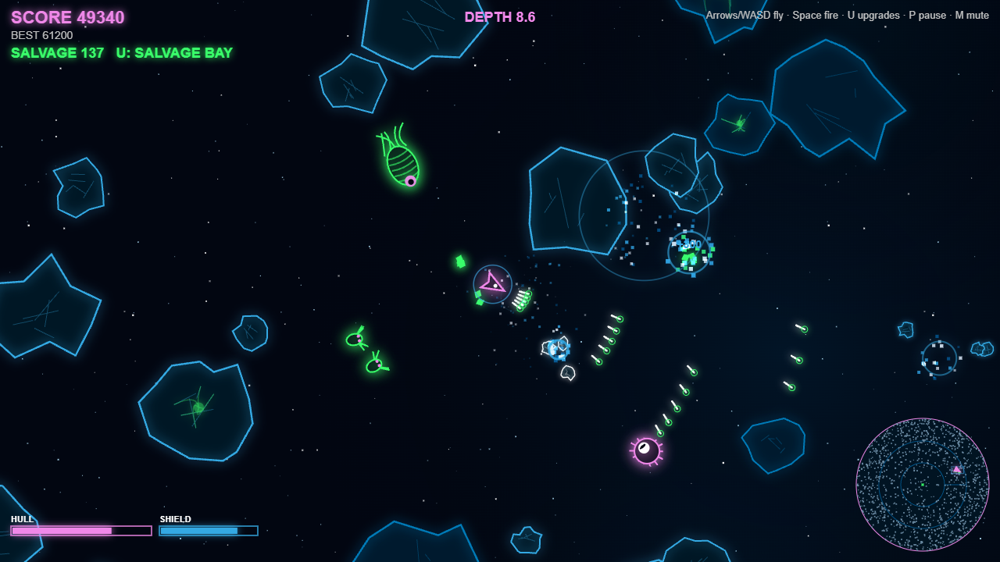
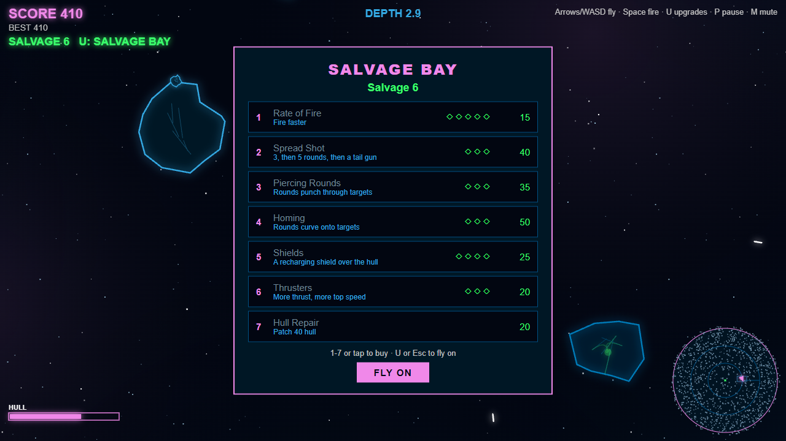
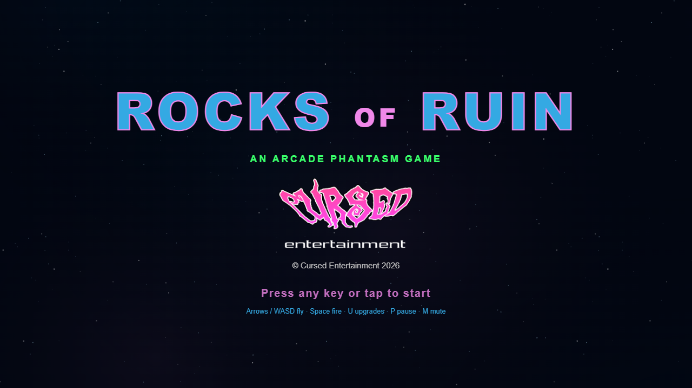

 

  

 

  
  
  

 

# ROCKS OF RUIN

**An [Arcade Phantasm](https://arcade-phantasm.netlify.app/) game** · **[Play it](https://cursedprograms.github.io/RocksOfRuin/)** in your browser, on a computer or a phone.

Navigate an enormous asteroid field. Asteroids split into smaller pieces, some hide alien creatures, and the salvage you collect upgrades your weapons. The field gets more dangerous the deeper you go.

**The twist:** Crack the wrong rock and something crawls out.

## Versions

Every version of the game lives in this repo.

| Version | Where | Status |
| --- | --- | --- |
| Browser | the repo root · [play it](https://cursedprograms.github.io/RocksOfRuin/) | this one, playable now |
| Windows exe | `cpp/` | coming |
| Android | `android/` · [APK](android/apk/) | playable |

## How to play

- You start at the **beacon**, the green ring at the heart of the field. The further out you fly (and the longer you last), the higher the **DEPTH**: rocks get denser and faster, more of them are alien nests, and **debris storms** blow streams of fast rocks across your path.
- Shoot the rocks: **big > medium > small > dust**. Blue-edged **iron** rocks take more hits and drop more salvage.
- Some rocks are **nests**. Watch for faint green veins pulsing inside. Crack one and something crawls out:
  - **Skitters**: fast little ticks that swarm straight at you.
  - **Spitters**: floating eyes that keep their distance and spit acid.
  - **Leeches**: fat slugs that stop, swell and lunge. Kill one and it splits into skitters.
  - **Wraiths**: they fade out of reach, circle you, then come back solid and dash. You can't hit them while they're faded.
- Pick up the green **salvage** that rocks and aliens drop (it's pulled in when you fly close), then press **U** to open the **salvage bay** (the game waits while it's open):
  rate of fire, spread shot, piercing rounds, homing, shields, thrusters and hull repair.
- Rocks and aliens wear down your **hull**. Shields soak hits first and recharge. When the hull's gone, so are you.
- The **minimap** (bottom right) shows the whole field, the rings of depth, the aliens and your view. Arrows at the screen edge point at aliens hunting you from off screen.
- Your best score is saved in the browser.

## Controls

| Key | Does |
| --- | --- |
| ← → or A D | turn |
| ↑ or W | thrust |
| ↓ or S | brake |
| Space | fire (hold) |
| U or Tab | salvage bay (1-7 buy, U or Esc to fly on) |
| P | pause |
| M | mute |
| Space or R | fly again after you're lost |

**On a phone:** the stick on the left turns you and thrusts when pushed far, **FIRE** on the right, **UPG** opens the salvage bay, **II** pauses.

## Android

The browser game in an Android app: it plays offline, full screen in landscape, with the sound on from the start
(Android 7.0 or newer).

- **Download**: the APK in [`android/apk/`](android/apk/). Copy it to the phone and open it (allow installs from
  unknown sources when asked).
- **Build it**: the Android SDK and JDK 17, then `android/build.bat` (or `build.ps1`, `build.sh`). It runs
  `gradlew assembleDebug` and leaves the APK in `android/apk/`. The game's web files are copied into the app at build
  time, so the browser game at the repo root stays the only copy.
- **The code**: `android/app/src/main/java/com/synthwomb/rocksofruin/MainActivity.kt`, a full-screen WebView that serves the
  game from the app's assets. Press Back twice to leave.

## The files

Plain HTML5 canvas and JavaScript, no frameworks and no build step: open `index.html` or serve the folder.

| File | What it is |
| --- | --- |
| `index.html` | the page: canvas, splash, salvage bay, touch controls |
| `site/style.css` | the page styling, in the Cursed colours |
| `site/game.js` | the game: the field, the ship, rocks, aliens, salvage, storms, the minimap |
| `site/sfx.js` | every sound, made with the Web Audio API (no audio files) |
| `images/` | the Cursed logo and the screenshots |

Add `#shot` to the URL for a frozen, busy moment deep in the field (it's how the screenshots are made).

## Also in the arcade

[KillerStardust](https://github.com/CursedPrograms/KillerStardust) · [ProtocolHex](https://github.com/CursedPrograms/ProtocolHex) · [Seance](https://github.com/CursedPrograms/Seance) · [RicochetReaper](https://github.com/CursedPrograms/RicochetReaper) · [GraveDanger](https://github.com/CursedPrograms/GraveDanger) · [Vortex](https://github.com/CursedPrograms/Vortex) · [Orbit](https://github.com/CursedPrograms/Orbit) · RocksOfRuin · [Devourer](https://github.com/CursedPrograms/Devourer)

 

© Cursed Entertainment 2026

 

